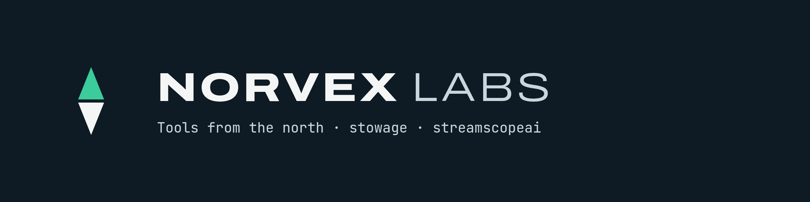

  

Norvex Labs builds small, dependable open-source tools for running software you control.

| Project | What it does | Language |
|---|---|---|
| [**stowage**](https://github.com/norvexlabs/stowage) | Package, publish and operate a self-hosted app on Docker, Kubernetes and a Kairos VM from one spec | Go |
| [**streamscopeai**](https://github.com/norvexlabs/streamscopeai) | Security, audit and cost-control gateway for LLM and agentic workloads | Rust |

Issues and pull requests are welcome on each project.
